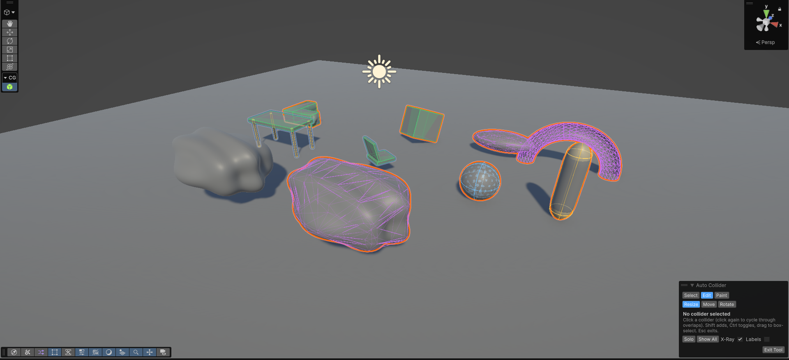
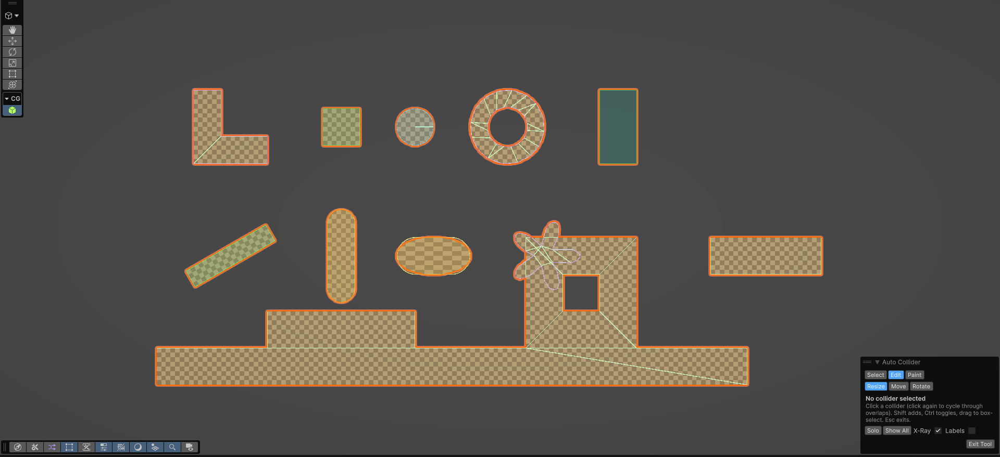

# Auto Collider

**Generate, optimize and edit colliders in Unity for 3D and 2D, for one object or a thousand.**




Auto Collider is a Unity editor extension that builds the cheapest collider that fits each object. Select your props,
press **Shift+Alt+C**, and each one gets a fitted collider: a box, sphere or capsule where one fits, a convex hull, convex
parts, or a simplified mesh collider. Sprites, tilemaps and flat meshes get 2D colliders the same way. Everything is
undoable, it never deletes colliders you made, and the runtime part has no editor code, so player builds stay clean.

## Contents
- [Features](#features)
- [Installation](#installation)
- [Quick start](#quick-start)
- [Collision events in code](#collision-events-in-code)
- [Strategies](#strategies)
- [Samples](#samples)
- [Documentation](#documentation)
- [Shortcuts and menus](#shortcuts-and-menus)
- [Design principles](#design-principles)
- [Repository layout](#repository-layout)
- [Feedback](#feedback)

## Features

### Generate
- **One click for any number of objects.** A batch of 1,000 props takes a couple of seconds and undoes in one step.
- **Auto strategy.** It chooses per mesh: a primitive when one fits, a convex hull for convex shapes, convex
  decomposition for concave shapes on moving Rigidbodies, and an optimized mesh collider for static ones. The window
  explains every choice.
- **Convex decomposition** is written in Burst C#, with no native plugins. Each part has at most 255 triangles (PhysX's
  limit), and parts that fit a primitive become boxes, spheres or capsules.
- **Live preview** with an estimated physics cost, and **presets** (High Quality, Balanced, Performance, Mobile, or your
  own preset assets).
- **Characters.** Skinned meshes get one collider per bone, parented to the bone, so the colliders follow the animation
  with no runtime code. Left and right bones can be kept symmetric.
- **LODs.** Optional per-LOD colliders, with a follower that enables only the active level's colliders.

### Optimize
- **Mesh Collider Optimizer:** analyze existing mesh colliders (triangles before and after, memory, accuracy), see an
  **error heatmap**, then simplify them. Originals are kept and can be restored.

### Edit in the Scene view
- An **edit tool** with face handles, move, rotate, vertex snapping, duplicate, mirror, merge, convert, refit,
  inflate / deflate, lock, solo and X-ray. Every operation is one undo step.
- **Paint mode:** paint triangles on the mesh and turn them into a collider. Painted regions are saved, so
  *Regenerate* rebuilds exactly the same colliders.

### 2D



- **Sprites** are traced from their pixels (no Read/Write needed). Each sprite gets a box, circle or capsule when one fits,
  otherwise a convex or simplified polygon, with holes kept.
- **Tilemaps:** either a live composite collider (follows tile edits), or one baked polygon with far fewer points.
- **Flat meshes** (2.5D): 3D art moved by a Rigidbody2D gets a 2D collider of its silhouette.
- **Skinned sprites** (2D Animation): one collider per bone. The package is optional.
- **Sprite Collider Switcher:** for frame-by-frame animation, it bakes one polygon per sprite from your Animator clips
  and swaps it at runtime without tracing or allocating.
- 2D editing (drag polygon points, simplify), painting, and every edit operation work on 2D colliders too.

### Runtime: the Collider Group
Every generated object gets a **Collider Group**, which treats all of its colliders as one unit:
- **Events that say which part was hit**, in 3D and 2D, with or without a Rigidbody. Each contact is reported once,
  even on compound bodies.
- **Bulk control:** enable / disable, trigger, layer, physics material, layer overrides, and contact reporting.
- An **Animated Mesh Collider** keeps a mesh collider in sync with a skinned mesh, with throttled updates.

### Collider Doctor
- Scans the selection or the whole scene for collider mistakes that break or slow down physics, and fixes them in one
  click. Examples:
  - concave mesh colliders on moving Rigidbodies
  - over-detailed mesh colliders and polygons
  - missing meshes and duplicate colliders
  - tilemaps without a composite
  - 2D and 3D physics mixed on one object
  - 2D objects tilted out of their plane
- *Fix All* applies every fix as a single undo step.

## Installation

Requirements: **Unity 6000.6 or newer**. Burst and Collections are installed automatically.

**Package Manager (Git URL).** Open *Window ▸ Package Manager ▸ + ▸ Add package from git URL…* and enter:

```
https://github.com/MFahril/auto-collider.git?path=/Packages/com.fahril.autocollider
```

**Or add it to `Packages/manifest.json`:**

```json
{
  "dependencies": {
    "com.fahril.autocollider": "https://github.com/MFahril/auto-collider.git?path=/Packages/com.fahril.autocollider"
  }
}
```

**Or embed it:** copy [`Packages/com.fahril.autocollider`](Packages/com.fahril.autocollider) into your project's
`Packages/` folder.

## Quick start

1. Select one or more objects in the Hierarchy: meshes, sprites, tilemaps or characters.
2. Press **Shift+Alt+C**, or right-click ▸ **Auto Collider ▸ Generate Colliders**. For options and a live preview, open
   **Tools ▸ Auto Collider ▸ Open Window**.
3. Each object gets a **Collider Group** that lists its colliders, where you can toggle, lock, regenerate or remove
   them. One **Ctrl+Z** undoes the whole batch.
4. Click **Edit in Scene** on the Collider Group to fine-tune colliders, and run **Tools ▸ Auto Collider ▸ Run Doctor** to
   check the scene.

## Collision events in code

```csharp
using AutoCollider;
using UnityEngine;

public class HitReporter : MonoBehaviour
{
    void OnEnable()
    {
        var group = GetComponent<ColliderGroup>();

        // 3D: which of this object's colliders was hit?
        group.CollisionEnter += (part, collision) => Debug.Log($"{collision.collider.name} hit {part.Label}");
        group.TriggerEnter   += (part, other)     => Debug.Log($"{other.name} entered {part.Label}");

        // 2D works the same way.
        group.CollisionEnter2D += (part, collision) => Debug.Log($"{collision.collider.name} hit {part.Label}");
        group.TriggerEnter2D   += (part, other)     => Debug.Log($"{other.name} entered {part.Label}");
    }
}
```

The group also has Stay and Exit events and bulk controls (`SetEnabled`, `SetTrigger`, `SetLayer`,
`SetPhysicsMaterial`, `SetLayerOverrides`, `Where(...)`, `WorldBounds`). The small relay components that route the
messages are added automatically, in play mode, the first time you subscribe.

## Strategies

| 3D strategy | Result |
|---|---|
| **Auto** (default) | Primitive if one fits, else a convex hull, else convex parts (moving) or an optimized mesh (static); per bone on skinned meshes |
| Best Primitive | Tightest of box, sphere and capsule |
| Box / Sphere / Capsule | That shape, rotated to fit when allowed |
| Convex Hull | One convex mesh, at most 255 triangles |
| Optimized Mesh | Simplified copy of the mesh: keeps holes and concave shapes (static / kinematic) |
| Convex Decomposition | Several convex parts: concave shapes on moving Rigidbodies |
| Per Bone | One collider per bone of a skinned mesh |

| 2D strategy | Result |
|---|---|
| **Auto** (default) | Box / circle / capsule if one fills the outline, else one convex polygon, else the simplified outline; per bone on skinned sprites |
| Best Primitive | Tightest of box, circle and capsule |
| Box / Circle / Capsule | That shape |
| Convex Polygon | One convex polygon around the outline |
| Polygon | The simplified outline, holes included |
| Edge | Edge loops along the outline (hollow) |
| Per Bone | One collider per bone of a skinned sprite |

## Samples

Import them from *Package Manager ▸ Auto Collider ▸ Samples*:

- **Demo** (3D): props to generate, a skinned robot arm, a LOD object, deliberate mistakes for the Doctor, and hit
  reports in Play mode. It uses URP materials.
- **Demo 2D:** sprites, a flat gear mesh and a tilemap to generate, a running character with sprite-swap colliders,
  2D mistakes for the Doctor, and 2D hit reports in Play mode.

Each sample's README walks through every feature step by step.

## Documentation

- [User manual](Packages/com.fahril.autocollider/Documentation~/index.md): every feature and setting, plus tips and
  troubleshooting
- [Changelog](Packages/com.fahril.autocollider/CHANGELOG.md)
- [Architecture and design notes](Docs/ARCHITECTURE_PLAN.md)
- [Roadmap and milestone log](Docs/ROADMAP.md)

## Shortcuts and menus

All shortcuts can be rebound in *Edit ▸ Shortcuts ▸ Auto Collider*.

| Key | Action |
|---|---|
| Shift+Alt+C | Generate colliders for the selection |
| 1 / 2 / 3 | Select / Edit / Paint mode (edit tool) |
| W / E / R | Move / Rotate / Resize |
| V (hold) | Snap to a mesh vertex or the sprite outline |
| Ctrl+D / Del | Duplicate / Delete |
| M / G / L | Mirror / Merge / Lock |
| H / X | Solo / X-ray |

- **Tools ▸ Auto Collider:** Open Window, Run Doctor, Project Settings
- **GameObject ▸ Auto Collider** (also on right-click in the Hierarchy): Generate Colliders, Remove Generated Colliders,
  Paint Colliders, Add Animated Mesh Collider, Add Sprite Collider Switcher

## Design principles

- **Safe by default.** Every change goes through Undo; one action is one Undo step, even for a batch of 1,000 objects. It
  only removes colliders it created and never changes your tags, layers, static flags or transforms.
- **Clean builds.** The runtime assembly has no `UnityEditor` references. All fitting, simplification and decomposition
  run in the editor.
- **No native dependencies.** Convex decomposition, mesh simplification and outline tracing are written in C#, with Burst
  where it pays off.
- **Project-friendly assets.** Generated meshes are saved as deduplicated sub-assets instead of being stored in your
  scenes, and source meshes don't need Read/Write enabled.
- **Deterministic.** The same input and settings always give the same colliders.
- **Tested.** 234 EditMode and 13 PlayMode tests cover the fitters, decomposition, undo, editing, 2D, events and the
  Doctor.

## Repository layout

```
Packages/com.fahril.autocollider/   the UPM package (Runtime, Editor, Tests, Samples~, Documentation~)
Docs/                               architecture plan, roadmap, README images
Assets/AutoCollider Dev/            development test scenes (3D props, 2D sprites and tilemap)
```

Open the repository as a Unity 6000.6 project to work on the package. Run the tests in *Window ▸ General ▸ Test Runner*
(EditMode: `AutoCollider.Editor.Tests`, PlayMode: `AutoCollider.Tests`).

## Feedback

Found a bug or have an idea? [Open an issue](https://github.com/MFahril/auto-collider/issues).

Made by **M. Fahril Ilmi**.
